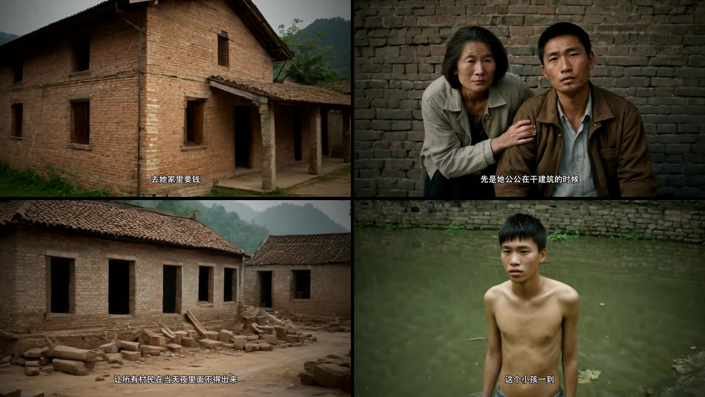

# 民俗恐怖视频生成器
**Folk Horror Video Generator**

> 粘贴一份故事稿或播音稿 → 自动产出分镜图、配音、字幕、转场、BGM,合成可直接发布的
> YouTube 长视频或 Shorts。
>
> *Paste a narration script → storyboard frames, voice-over, subtitles, transitions and BGM,
> assembled into a ready-to-publish YouTube video or Short.*

> [!WARNING]
> **🚧 早期实验版 (v0.1)** —— 个人工作流工具,已用于实际出片,但依赖本地 ComfyUI、
> 单用户运行、配置项较多。欢迎试用和反馈。

本项目是 **[中国民俗恐怖 · 视觉记忆系统](https://github.com/Sanniu1993/folk-horror-visual-memory)**
的下游生成器:出图时会检索视觉记忆库,把经人工审核的民俗视觉知识注入提示词。



## 流程


旁白时长驱动一切:每张图显示多久、字幕何时出现,都由对应句子的配音时长决定,
所以音画字幕天然同步。

## 功能

**生成**
- 稿件驱动,分镜图 1–40 张可选
- 四种语言:中文 / English / 日本語 / 한국어(配音音色、字幕字体与换行规则随语言切换)
- 画幅:横版 16:9(YouTube 长视频)/ 竖版 9:16(Shorts)
- 风格:`auto`(跟随剧情)/ `horror` / `realistic` / `none`;可选「美术设定」约束年代、服饰、环境
- 语速两档;句间静音自动压缩,节奏紧凑
- 人工审核模式:出图后先停下,可逐张带修改要求重出,确认后再合成

**合成**(纯 ffmpeg,无需 GPU)
- 9 种 Ken Burns 运镜、电影感调色、胶片颗粒与暗角
- 10 种镜头转场(溶解、滑动、擦除、圆开等),交叠后仍保持音画同步
- 字幕每屏最多两行、随语音分段滚动
- BGM 垫底:循环铺满、淡入淡出、旁白响起时自动闪避

**视觉记忆增强**
- 每个镜头按画面内容检索记忆库,把命中的视觉标签注入提示词(可选用命中图做 IPAdapter 参考)
- 「🔍 RAG 检索调试」面板逐镜头展示:检索 query、命中条目与分数、是否被采用、
  实际注入的片段
- 记忆库没启动时自动跳过,不影响出图

**其他**
- 生成全程计时;输出目录按 AI 起的中文标题命名,方便查找
- 批量脚本:一次把 `inputs/` 下多份稿件生成多个视频

## 环境要求

- Python 3.9+,能访问外网(DeepSeek API、edge-tts 配音)
- 本地运行的 **ComfyUI**,checkpoints 目录放入
  `RealVisXL_V5.0_Lightning_fp16.safetensors`(或在 `config.yaml` 换成你的 SDXL 模型)
- 可选:ComfyUI IPAdapter 插件与模型(用于参考图增强)

参考速度(Apple Silicon Mac):单张图约 20–35 秒,40 张图的长视频约 20–25 分钟出图。

## 快速开始

```bash
git clone https://github.com/Sanniu1993/video-generate-by-desc.git
cd video-generate-by-desc
python3 -m venv .venv && .venv/bin/pip install -r requirements.txt
cp .env.example .env            # 填入 DEEPSEEK_API_KEY
# 先启动 ComfyUI(默认 127.0.0.1:8188)
.venv/bin/uvicorn main:app --reload --app-dir backend
```

打开 http://127.0.0.1:8000 ,粘贴稿件,选语言 / 画幅 / 风格 / 分镜数,点「生成」。

### 批量生成

```bash
# 把稿件放成 inputs/story1.txt、story2.txt …;参数写在脚本顶部的 SETTINGS
.venv/bin/python backend/batch_generate.py
```

### 启用视觉记忆增强

先按 [视觉记忆系统](https://github.com/Sanniu1993/folk-horror-visual-memory) 的说明启动记忆库
(默认 8100 端口),本项目 `config.yaml` 中 `visual_memory.enabled: true` 即可。

## 主要配置(`config.yaml`)

| 配置 | 作用 |
|------|------|
| `generation.*` | 出图模型、步数、CFG、采样器(默认 Lightning 8 步) |
| `video.transition_seconds` | 转场时长,0 为硬切 |
| `video.bgm.*` | BGM 开关、文件或目录、音量、闪避、淡入淡出(音乐放 `assets/bgm/`) |
| `video.tts.*` | 语速、静音压缩、各语言音色 |
| `visual_memory.*` | 记忆库地址、检索条数、相似度门槛、参考图开关 |

## 已知局限

- 依赖本地 ComfyUI 与 SDXL 模型;长时间连续出图时 Mac 会降频变慢。
- edge-tts 走微软的公开端点,偶发失败(已内置重试)。
- 任务存于内存,单用户使用;服务重启后进行中的任务会丢失。
- 不附带 BGM 与素材;公开发布请使用可商用音乐。

## License

[MIT](LICENSE)
